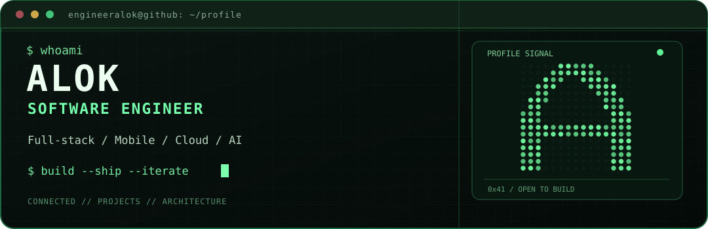

<!-- GitHub profile • designed for @engineeralok -->

<!-- 01 / INTRO -->
<div align="center">

<sub>WELCOME TO MY GITHUB PROFILE</sub>

# Hi, I'm Alok 👋

### [Software Engineer](https://engineeralok.dev)

Building modern applications, scalable backend systems, and AI-powered software products.

[**Portfolio**](https://engineeralok.dev) · [**LinkedIn**](https://www.linkedin.com/in/engineeralok/) · [**Projects**](https://github.com/engineeralok?tab=repositories)

</div>

<br />

<!-- 02 / TERMINAL (already present in the GitHub repository) -->
<div align="center">



</div>

<br />

<!-- 03 / CONTRIBUTION SNAKE (requires included GitHub Actions workflow) -->
### 03 — Contribution snake

<div align="center">

<picture>
  <source media="(prefers-color-scheme: dark)" srcset="https://raw.githubusercontent.com/engineeralok/engineeralok/output/github-contribution-grid-snake-dark.svg" />
  <source media="(prefers-color-scheme: light)" srcset="https://raw.githubusercontent.com/engineeralok/engineeralok/output/github-contribution-grid-snake.svg" />
  
</picture>

<sub>Generated from GitHub contributions. This appears after the snake workflow publishes its first output.</sub>

</div>

<br />

<!-- 04 / REPOSITORIES -->
### 04 — Selected repositories

A small selection of my public work, across mobile engineering and full-stack development.

| Project | Engineering focus | Stack |
| :--- | :--- | :--- |
| [**Learn with Jiji**](https://github.com/engineeralok/learnwithjiji) | Adaptive-learning app UI, app navigation and structured state management | Flutter · Riverpod · Dart |
| [**Panam Properties**](https://github.com/engineeralok/panam-properties) | Responsive real-estate website | TypeScript · React |
| [**RiverPod with Flutter**](https://github.com/engineeralok/RiverPod_with_Flutter) | Flutter state-management patterns and examples | Flutter · Riverpod |
| [**Flutter Referral App**](https://github.com/engineeralok/flutter-referral-app-with-firebase) | Flutter and Firebase referral app example | Flutter · Firebase |

<sub>Some commercial and client work is private or client-owned; the links above lead to publicly available code.</sub>

<br />

<!-- 05 / TECH + ACHIEVEMENTS -->
### 05 — Technologies & achievements

**Languages and application development**

<div align="center">


</div>

**Databases and infrastructure**

<div align="center">


</div>

**GitHub milestones**

<div align="center">


</div>

<br />

<!-- 06 / REST OF THE DETAILS -->
### 06 — About & activity

I'm **Alok**, a software engineer based in India. I work across mobile applications, full-stack web development, APIs and cloud deployment. I enjoy taking ideas through implementation, integration, and delivery.

```text
$ cat current-focus.txt
> Building useful software products and SaaS tools
> Designing clean APIs and maintainable applications
> Exploring practical AI integrations and automations
> Improving developer experience, testing and delivery
```

**Areas of interest:** `Software architecture` · `Mobile engineering` · `Backend APIs` · `Cloud infrastructure` · `AI agents`

<details>
<summary><b>View GitHub activity & stats</b></summary>
<br />

<div align="center">


</div>

</details>

---

<div align="center">

**Let's build something useful.**

[Portfolio](https://engineeralok.dev) · [LinkedIn](https://www.linkedin.com/in/engineeralok/) · [GitHub](https://github.com/engineeralok)

<sub>Designed with care · Built with curiosity</sub>

</div>
